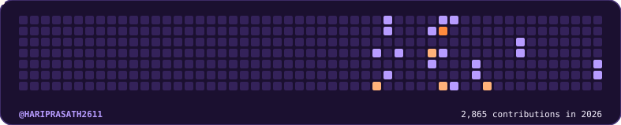

  <!-- 1. TOP BAR & HERO SECTION -->
  

  <!-- 2. MAIN QUEST CARD -->
  

  <!-- 3. INVENTORY (TECH STACK) CARD -->
  

  <!-- 4. COMMIT LOG CARD -->
  

  <!-- 5. REAL CONTRIBUTION SNAKE ANIMATION -->
  <a href="https://github.com/HARIPRASATH2611">
    <picture>
      <source media="(prefers-color-scheme: dark)" srcset="https://raw.githubusercontent.com/HARIPRASATH2611/Hariprasath2611/output/github-contribution-grid-snake-dark.svg" />
      <source media="(prefers-color-scheme: light)" srcset="https://raw.githubusercontent.com/HARIPRASATH2611/Hariprasath2611/output/github-contribution-grid-snake.svg" />
      
    </picture>
  </a>

  <!-- 6. FOOTER & CONNECT CARD -->
  

   

  <!-- ACCESSIBLE LINKS ROW -->
  

    <a href="https://hariprasathportfolio-zeta.vercel.app/">🌐 <b>Portfolio Website</b></a>
    &nbsp;&nbsp;&bull;&nbsp;&nbsp;
    <a href="mailto:hariprasathd26112006@gmail.com">✉️ <b>Email Me</b></a>
    &nbsp;&nbsp;&bull;&nbsp;&nbsp;
    <a href="https://github.com/HARIPRASATH2611?tab=repositories">📦 <b>All Projects</b></a>
  

  

    
<b>🔍 Quick Links to Featured Repositories</b>

     
    

      <ul>
        <li>🚘 <a href="https://github.com/Hariprasath2611/Ryde"><b>Ryde</b></a> — On-demand driver booking app (Customers book a professional driver for their own vehicle. React Native and Node).</li>
        <li>🎓 <a href="https://github.com/Hariprasath2611/CCR-App"><b>CCR-App</b></a> — Campus ERP attendance module (Faculty attendance on mobile, built with React Native and Expo).</li>
        <li>🔐 <a href="https://github.com/Hariprasath2611/SIH26125-LuminaryForge"><b>SIH26125-LuminaryForge</b></a> — SIH 2026 identity platform (Blockchain identity, access control and digital assets).</li>
      </ul>
    

  

